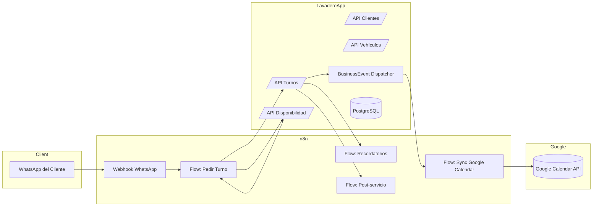
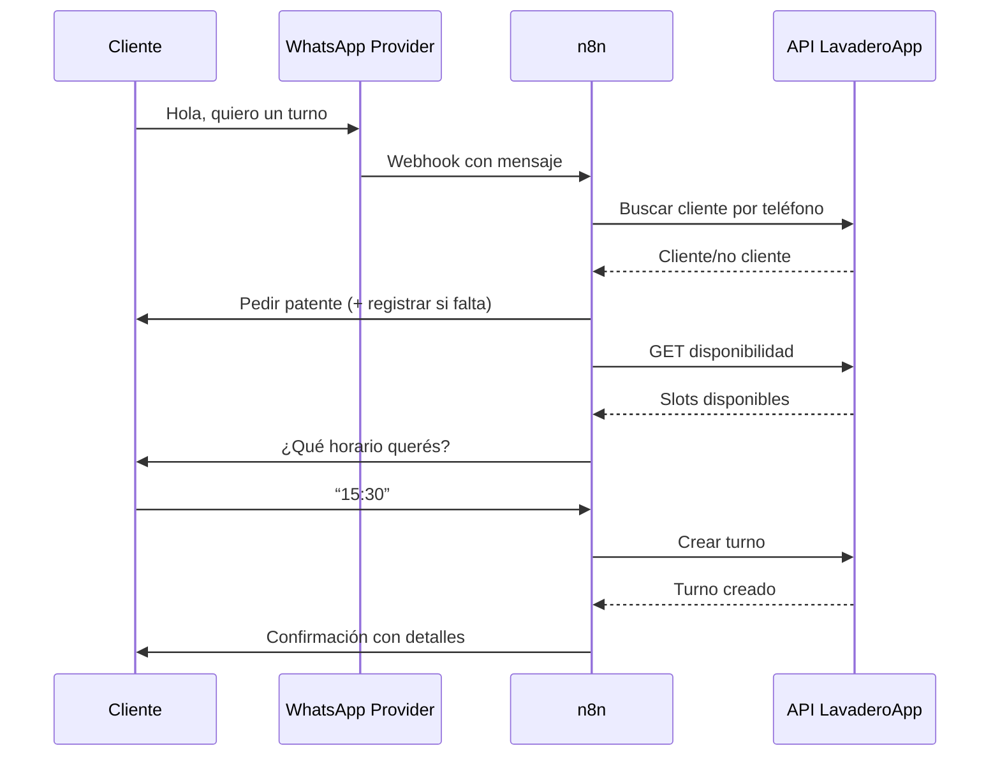
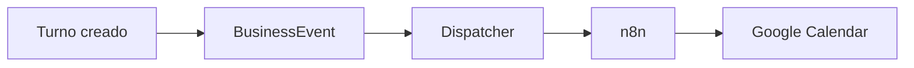

# LavaderoApp + n8n

# **Arquitectura Integral, Nuevo Módulo de Automatizaciones y Diseño para Escalar un SaaS Verdadero**

Este documento define **cómo reestructurar y potenciar LavaderoApp** para convertirla en una plataforma SaaS completa, inteligente, automatizable y vendible, integrando:

- n8n como motor central de automatización
- WhatsApp como canal operativo natural
- Google Calendar como agenda espejo
- Un nuevo módulo de **Automations** + Events + Webhooks
- APIs limpias para flujo conversacional y turnos
- Reestructuración del módulo `notifications`
- Soporte multitenant para cientos de lavaderos

Está escrito para ser **el README maestro** de la nueva versión de LavaderoApp.

---

# 1. VISIÓN GENERAL

LavaderoApp evoluciona desde un “ERP liviano de lavaderos” hacia una **plataforma operativa asistida por automatizaciones**, capaz de:

- Atender clientes por WhatsApp automáticamente
- Gestionar turnos sin intervención humana
- Crear y actualizar agendas de Google Calendar
- Sincronizar eventos relevantes del negocio con n8n
- Enviar notificaciones inteligentes (email / WhatsApp)
- Reducir trabajo manual en recepción y coordinación
- Aumentar la fidelidad del cliente con recordatorios, confirmaciones y campañas

El motor no es Django. El motor es:

> **Django = Fuente de la verdad del negocio**  
> **n8n = Capa de automatización y comunicación externa**

---

# 2. ARQUITECTURA GENERAL

## 2.1 Diagrama de arquitectura (macro)



---

# 3. PRINCIPIOS DIRECTORES

1. **Django siempre es la fuente de verdad.**  
   Turnos, estados, clientes, vehículos.

2. **n8n maneja TODOS los canales externos.**  
   WhatsApp, Google Calendar, Email real.

3. **Eventos de negocio unificados.**  
   Django no llama a WhatsApp ni Google nunca.  
   Solo registra eventos → n8n actúa.

4. **Multitenancy estricto.**  
   Cada empresa tiene su `automation_config`.

5. **APIs limpias y predecibles para automatizaciones.**

---

# 4. ESTRUCTURA DE MÓDULOS

```
apps/
├── accounts/
├── org/
├── customers/
├── vehicles/
├── sales/
├── cashbox/
├── notifications/         # Rediseñado: plantillas + logs + preview
├── automations/           # NUEVO: eventos + dispatcher + configs
└── api/                   # Endpoints REST para n8n
```

---

# 5. MÓDULO `automations` (NUEVO Y CENTRAL)

## 5.1 Objetivo

Centralizar:

- Webhooks hacia n8n
- Configuración de automatización por empresa
- Registro de eventos de negocio (`BusinessEvent`)
- Dispatcher de eventos hacia n8n
- Auditoría de envíos

## 5.2 Modelos

### `AutomationConfig`

- `empresa`
- `n8n_webhook_url`
- `n8n_api_key` (opcional)
- `calendar_enabled` (bool)
- `calendar_id`
- `timezone`
- flags:
  - `auto_turnos`
  - `auto_recordatorios`
  - `auto_post_servicio`

### `BusinessEvent`

- `id`
- `empresa`
- `tipo`  
  Ej: `turno_creado`, `turno_cancelado`, `venta_terminada`, `cliente_creado`
- `payload` (JSON)
- `estado`: `pendiente`, `enviado`, `error`
- timestamps

## 5.3 Servicios

### `event_publisher.py`

- Crea eventos y los marca `pendiente`.

### `dispatcher.py`

- Toma eventos pendientes.
- Llama al webhook n8n:
  - Headers con `empresa_id`
  - Body con `payload`
- Cambia estado a `enviado` o `error`.

## 5.4 Hooks desde otros módulos

Eventos recomendados:

- `cliente_creado`
- `vehiculo_creado`
- `turno_creado`
- `turno_reprogramado`
- `turno_cancelado`
- `turno_completado`
- `venta_terminada`
- `pago_registrado`

Ejemplo payload:

```json
{
  "id_turno": "UUID",
  "cliente": {
    "nombre": "...",
    "telefono": "+549381..."
  },
  "vehiculo": { "patente": "ABC123" },
  "fecha": "2025-01-01",
  "hora": "15:30",
  "sucursal": "Centro"
}
```

---

# 6. REDISEÑO DEL MÓDULO `notifications`

`notifications` se mantiene pero su rol cambia:

- Guarda PLANTILLAS (email / whatsapp)
- Renderiza contenidos
- Guarda logs de envíos
- Permite vista previa
- Pero ya **no** envía WhatsApp real  
  (n8n se encarga)

### Nuevos objetivos

- Ofrecer plantillas para n8n (flujo dinámico)
- Exponer API para que n8n pida plantillas renderizadas

API sugerida:

```
POST /api/notifications/render/
Body:
  plantilla: "turno_confirmado"
  venta_id: ...
  turno_id: ...
  cliente_id: ...
```

---

# 7. APIs PARA n8n

## 7.1 Clientes

```
GET  /api/clientes/by-phone/?numero=...
POST /api/clientes/
```

## 7.2 Vehículos

```
GET  /api/vehiculos/?cliente_id=...
POST /api/vehiculos/
```

## 7.3 Disponibilidad de turnos

```
GET /api/turnos/disponibilidad/?fecha=YYYY-MM-DD&franja=tarde
```

## 7.4 Crear turno

```
POST /api/turnos/
{
  "cliente_id": "...",
  "vehiculo_id": "...",
  "fecha": "...",
  "hora": "...",
  "sucursal_id": "..."
}
```

## 7.5 Cancelar turno

```
POST /api/turnos/<uuid>/cancelar/
```

## 7.6 Render plantillas

```
POST /api/notifications/render/
```

---

# 8. INTEGRACIÓN CON WHATSAPP (n8n)

## 8.1 Flujo: pedir turno



---

# 9. INTEGRACIÓN CON GOOGLE CALENDAR

## 9.1 Flujo: espejo de agenda

Cuando se crea/reprograma/cancela un turno:

1. Django crea `BusinessEvent`.
2. Dispatcher llama a n8n.
3. n8n actualiza Google Calendar.



---

# 10. MULTITENANCY + n8n

Cada empresa tiene:

- `n8n_webhook_url`
- `api_key` opcional
- `calendar_id`

n8n debe enviar siempre:

```
X-Empresa-ID: <UUID>
X-API-Key: <key>
```

Django filtra todo por `empresa_activa`.

---

# 11. INFRAESTRUCTURA (DOCKER + VPS)

## 11.1 Contenedores recomendados

```
docker/
├── lavaderoapp/
│   ├── Dockerfile
│   ├── gunicorn.conf
├── n8n/
│   ├── Dockerfile
│   ├── n8n.env
├── postgres/
│   ├── init.sql
└── reverse-proxy/
    ├── nginx.conf
```

## 11.2 Servicios

- Postgres 14+
- LavaderoApp (Django + Gunicorn)
- Redis (opcional para colas)
- n8n
- Nginx reverse proxy

---

# 12. FLUJOS n8n SUGERIDOS

## 12.1 Flujo 1: Pedir turno

- Trigger: Webhook inbound de WhatsApp
- Pasos:
  - Parse texto → detectar intención
  - Consultar cliente
  - Registrar si falta
  - Pedir patente
  - Consultar disponibilidad
  - Confirmar
  - Crear turno en API

## 12.2 Flujo 2: Recordatorios

- Trigger: Cron cada 15 min
- Lógica:
  - Consultar API `/api/turnos/proximos`
  - Enviar recordatorios
  - Marcar “recordatorio_enviado”

## 12.3 Flujo 3: Post-servicio

- Trigger: evento `turno_completado`
- Enviar WhatsApp con:
  - agradecimiento
  - reseña
  - cupón

## 12.4 Flujo 4: Sync Google Calendar

- Trigger: evento `turno_creado` / `turno_reprogramado` / `turno_cancelado`
- Upsert de evento en Calendar

---

# 13. MODELOS RECOMENDADOS PARA TURNOS

```
Turno:
- cliente
- vehiculo
- sucursal
- fecha
- hora
- estado: pendiente / confirmado / completado / cancelado
- comentarios
```

---

# 14. PERMISOS

- `AUTOMATIONS_MANAGE`
- `NOTIFICATIONS_MANAGE`
- `TURNOS_API_WRITE`
- `TURNOS_API_READ`

---

# 15. ROADMAP OFICIAL

## Fase 1 — Fundaciones

- Crear `automations`
- Implementar `BusinessEvent`
- Dispatcher hacia n8n
- API de turnos + clientes

## Fase 2 — WhatsApp inteligente

- Flujo completo pedir turno
- Autoregistro de cliente/vehículo
- Confirmación automática

## Fase 3 — Google Calendar

- Sync espejo
- Config por empresa

## Fase 4 — Marketing y fidelización

- Post-servicio
- Campañas
- Re-engagement cada 60 días

## Fase 5 — Cockpit de automatizaciones

- UI para pruebas de webhooks
- Logs de eventos
- Pruebas de flujos

---

# 16. BENEFICIOS COMERCIALES

- El lavadero deja de contestar WhatsApp manual
- Turnos automáticos = menos carga
- Agenda siempre actualizada
- Servicio profesional sin personal adicional
- Diferenciación absoluta frente a la competencia
- SaaS “plug-n-play” escalable y vendible

---

# 17. RESUMEN EJECUTIVO

**LavaderoApp + n8n** es ahora:

- Un sistema de gestión
- Un asistente automatizado
- Una agenda digital
- Un chatbot operativo
- Un motor de recordatorios
- Una plataforma de fidelización
- Un sistema listo para vender

Con este rediseño estás creando **tu primer SaaS real**, escalable, automatizable, diferenciador y con propuestas de valor claras.
